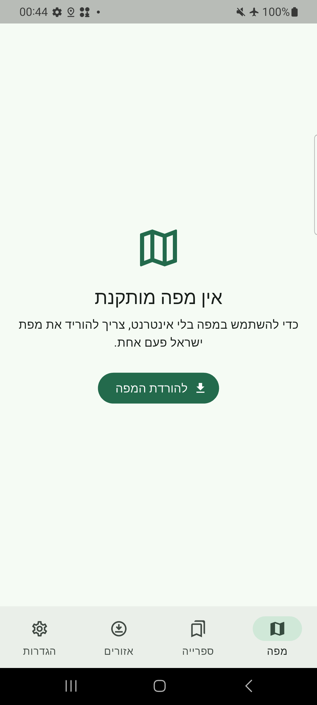
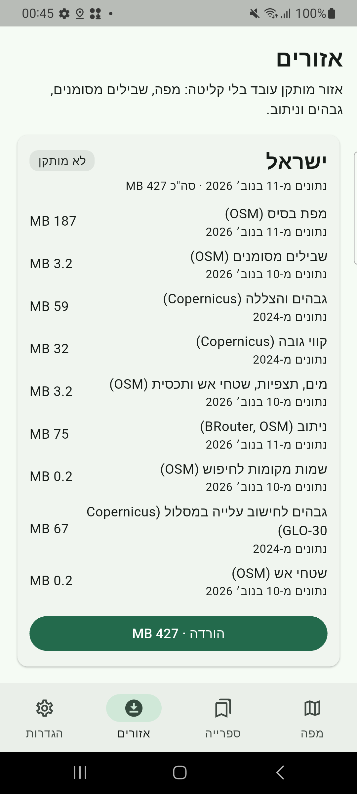
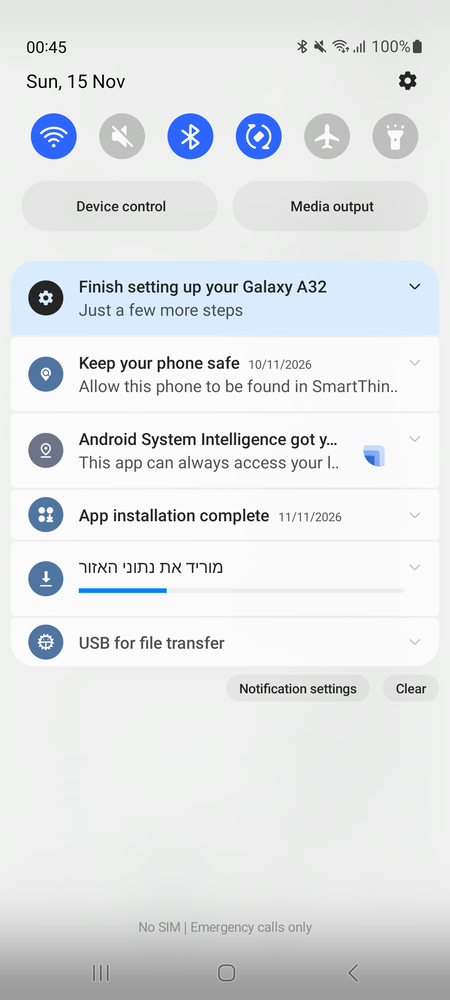

# התקנת TrailApp: מדריך של עמוד אחד

## הורדה

- **הקובץ:** [TrailApp-1.0.0-10.apk](https://github.com/yashivdafna/trailapp-app/releases/download/v1.0.0-10/TrailApp-1.0.0-10.apk) (גרסה 1.0.0, בנייה 10, כ-56 MB). כל הגרסאות: [Releases](https://github.com/yashivdafna/trailapp-app/releases).
- פותחים את הקישור בדפדפן של הטלפון. הקובץ יורד ל"הורדות", ואז ממשיכים לפי השלבים כאן.
- טביעת האצבע (SHA-256) של הקובץ, למי שרוצה לבדוק: `fde5b5320912d1025290e54c52a383bdbc1829072e9e89e7bc68e5460ae823ac`
- במאגר הזה יש רק את קובץ ההתקנה ואת המדריך. קוד המקור לא כאן.

TrailApp היא אפליקציית טיולים לישראל. היא מראה עובדות והערכות: מרחק, עלייה, ירידה, מים ושבילים. מי שהולך מחליט. האפליקציה לא מחליטה בשבילך.

## שלב 1: מה צריך לפני שמתחילים

- הקובץ `TrailApp-1.0.0-10.apk` (כ-56 MB). את הקובץ שלחו לך, או שהוא מחכה בהורדות של הטלפון. זה "הקובץ שקיבלת".
- **מקום פנוי בטלפון:** כ-150 MB לשימוש אונליין; כ-700 MB אם מורידים גם את מפת ישראל המלאה (427 MB) לשימוש בלי קליטה. בתחילת הורדת המפה האפליקציה בודקת שיש 10% יותר ממה שהיא עומדת להוריד, כלומר כ-470 MB. אחרי ההתקנה אפשר למחוק את הקובץ מההורדות.
- Wi-Fi, אם מורידים את המפה המלאה.

האפליקציה אינה בחנות Google Play. לכן אנדרואיד ישאל אותך שתי שאלות בזמן ההתקנה. זה רגיל.

> אם אתה לא בטוח שהקובץ הגיע מהאדם שאתה מכיר, אל תתקין.

## שלב 2: התקנה מהקובץ

> **חשוב לדעת:** צעדים 2.2 ו-2.3 נכתבו **בלי צילום מסך** מטלפון אמיתי. הניסוח המדויק של החלונות והכפתורים משתנה מטלפון לטלפון ומגרסת אנדרואיד לגרסה. לכן כתוב "ייתכן שתראה". אם אצלך זה נראה אחרת, חפש את הכפתור שמאשר את ההתקנה.

**2.1.** פתח את הקובץ: ב"הורדות" (או "הקבצים שלי"), או בלחיצה עליו בדפדפן או ב-WhatsApp.

**2.2. שאלה ראשונה: התקנה מהמקור הזה.** ייתכן שתראה הודעה שאנדרואיד לא מאפשר התקנה מהמקור הזה (הדפדפן, WhatsApp או "הקבצים שלי"), עם כפתור להגדרות. בהגדרות ייתכן שתמצא מתג בשם דומה ל"אפשר התקנה מהמקור הזה". בסמסונג ייתכן שההגדרה נקראת בשם דומה ל"התקנת אפליקציות לא מוכרות". הפעל אותו וחזור אחורה.

**2.3. שאלה שנייה: Google Play Protect.** ייתכן שתראה חלון שמציע לסרוק את האפליקציה, או אזהרה שהאפליקציה לא מוכרת. אפשר לבחור לסרוק. ייתכן שיהיה כפתור להמשיך בהתקנה בכל זאת, בניסוח דומה ל"התקן בכל זאת". בסמסונג ראינו (17.11.2026): "App scan recommended", לוחצים "Scan app", אחרי כמה שניות מופיע "This app looks safe", ולוחצים "Install".

**2.4.** לחץ "התקנה". בסוף לחץ "פתיחה".

### אם הטלפון מסרב להתקין בכלל

Google הודיעה שתתחיל לבדוק אפליקציות שלא מגיעות מחנות. לפי מה ש-Google פרסמה, זה **לא צפוי עכשיו** בהתקנה מקובץ בישראל. זה צפוי בכל העולם בשנת 2027. אם בכל זאת תראה הודעה שההתקנה נחסמה, או שהאפליקציה "לא נבדקה" או "ממפתח לא מאומת": **זה לא משהו שעשית לא נכון. אל תנסה לעקוף את החסימה.** צלם את המסך ושלח לאדם ששלח לך את הקובץ.

## שלב 3: הפעלה ראשונה, ומפה מלאה לשטח בלי קליטה

מבנייה 8 האפליקציה עובדת **אונליין מיד**: המפה, החיפוש, בניית מסלול והמספרים שלו, בלי להוריד כלום מראש. במסלול הראשון באזור יורדים נתוני ניתוב קטנים לאזור (בדרך כלל פחות מ-1 עד 6 MB), ומאז הניתוב באזור הזה עובד גם בלי קליטה.

**מבנייה 10 אפשר להוריד רק את האזור שבו מטיילים**, במקום את כל הארץ: במפה, בכפתור "הורדת האזור שעל המסך", או במסלול שמור, בשורה "הורדה לשטח". ההורדה כוללת את המפה, הגבהים והניתוב של האזור, ובדרך כלל היא כמה MB בלבד. בזמן ההורדה יש כפתור "עצירה". האזורים שהורדו מופיעים בלשונית "אזורים", ומשם אפשר למחוק אותם.

מי שיוצא לשטח בלי קליטה ורוצה את כל הארץ בטלפון מוריד את מפת ישראל המלאה פעם אחת, בלשונית "אזורים":

(התמונה הבאה היא מבנייה קודמת, שבה היה חובה להוריד.)

**3.1.** התחבר ל-Wi-Fi. ההורדה גדולה: **427 MB**.

**3.2.** עבור ללשונית "אזורים" (למטה).

**3.3.** לחץ על הכפתור הירוק "הורדה · 427 MB".

**3.4.** אנדרואיד עשוי לשאול אם אפשר לשלוח לך התראות. לחץ "אפשר" (Allow). ההתראה מראה את ההתקדמות.

**3.5.** **אפשר לנעול את הטלפון בזמן ההורדה.** היא ממשיכה. אם נקטעה, לחץ שוב על "הורדה" והיא תמשיך מאותה נקודה.

**3.6.** כשהסתיימה, בלשונית "אזורים" יופיע "מותקן".

## שלב 4: אחרי זה, בלי קליטה

אחרי ההורדה המלאה האפליקציה עובדת **בלי אינטרנט ובלי קליטה** בכל הארץ: מפה, חיפוש מקום, בניית מסלול ושמירה.

## שלב 5: עדכון לגרסה חדשה

כשיש קובץ חדש, מתקינים אותו **על הישן**. המסלולים השמורים נשארים. מה שנבדק: בטלפון אחד, עדכון מבנייה 1 לבנייה 2 נעשה **בפקודת התקנה מהמחשב** (`adb install -r`), ולא בפתיחת קובץ בטלפון. אחריו נשארו המסלול השמור, ההקלטה, המפה וההגדרות. עדכון בפתיחת קובץ, כמו בשלב 2, לא נבדק.

**התנאי:** לפי התיעוד הרשמי של אנדרואיד, עדכון מותקן רק כשהוא חתום **באותו מפתח** כמו האפליקציה שכבר בטלפון, ואנדרואיד לא מתקין גרסה **ישנה יותר** על חדשה יותר. לכן קובץ שלא הגיע מאותו שולח, או גרסה ישנה, לא יותקן על הקיים. אין צורך להסיר את האפליקציה. **אל תסיר את האפליקציה כדי "לנקות"**: הסרה מוחקת את המסלולים השמורים.

**עדכון מתוך האפליקציה:** בהגדרות, בכרטיס "על האפליקציה", יש "בדיקת עדכונים". כשיש חיבור לאינטרנט האפליקציה מציעה גרסה חדשה יותר, ומתקינה אותה רק אם היא חתומה באותו מפתח (מאותו שולח). בפעם הראשונה אנדרואיד יבקש לאשר ל-TrailApp "התקנת אפליקציות לא מוכרות". בסמסונג ייתכן שיופיע דף עם רשימה של כל האפליקציות: גלול אל TrailApp, הפעל את המתג שלה וחזור אחורה. הבדיקה מתבצעת רק כשנכנסים להגדרות או לוחצים על הכפתור, לא ברקע. גם בעדכון מתוך האפליקציה ייתכן שיופיע החלון של Google Play Protect משלב 2.3; עונים עליו באותה דרך. **שים לב:** מי שמותקנת אצלו בנייה 1 עד 4 מעדכן לגרסה החדשה בקובץ; מבנייה 5 ואילך אפשר לעדכן מתוך האפליקציה.

## שלב 6: מי מקבל דיווח על בעיה

ספר לאדם ששלח לך את הקובץ: מה לחצת, מה ציפית לראות ומה ראית. צילום מסך עוזר מאוד. האפליקציה לא שולחת שום דיווח לבד.

אפשר גם לכתוב לכתובת trailapp.support@gmail.com. בהגדרות, בכרטיס "על האפליקציה", לחץ "דיווח על תקלה או הצעה": אפליקציית הדואר נפתחת עם הכתובת, ועם מספר הגרסה, גרסת האנדרואיד ודגם הטלפון כבר בהודעה. כתוב מה קרה ולחץ שליחה בעצמך.
